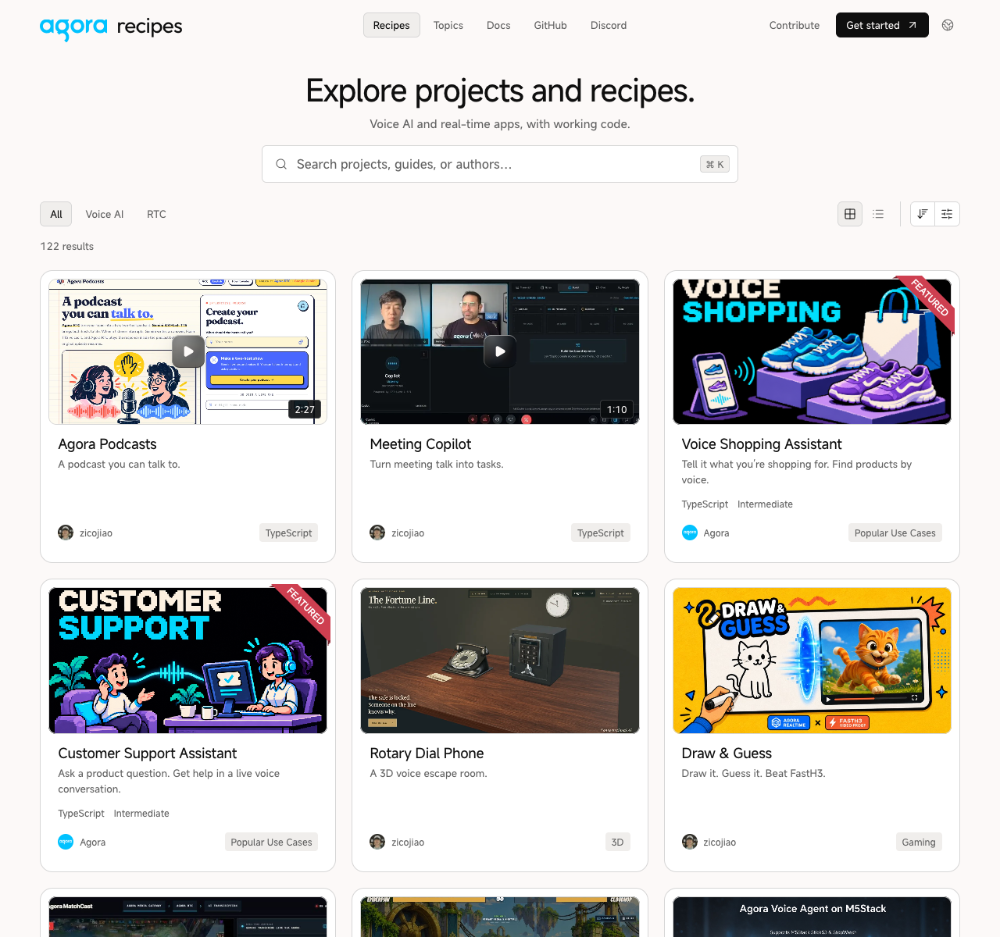
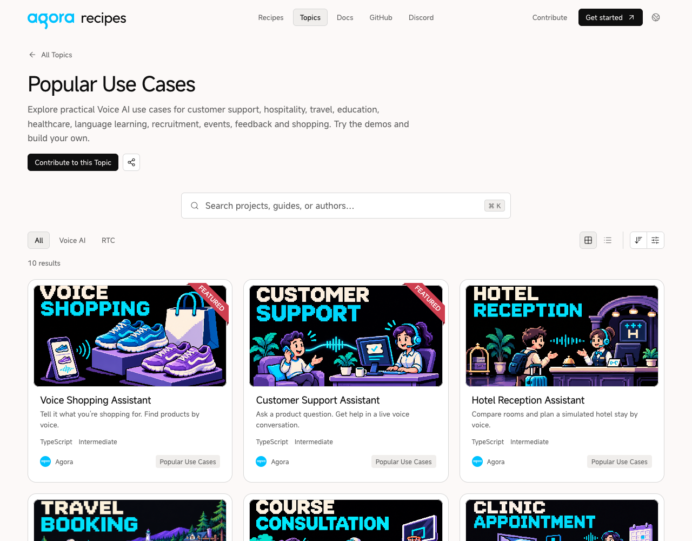
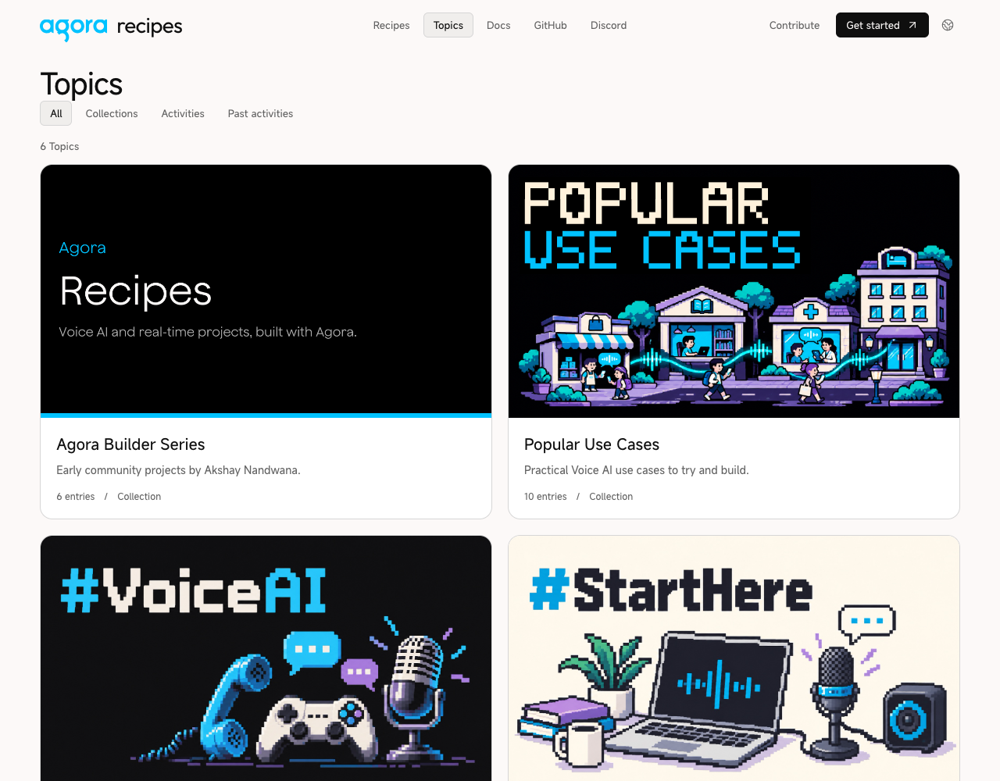
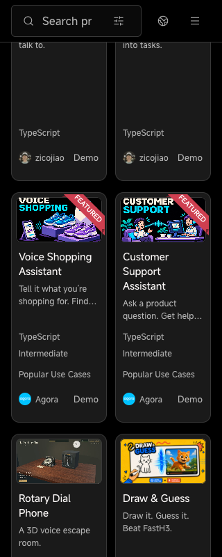

# Popular Use Cases review evidence

The collection is named Popular Use Cases and lives at `/topics/popular-use-cases`.
The retired `/topics/top-10` route permanently redirects to the new route, including
localized variants, preserving query parameters. Its ten members remain in the collection, with Voice Shopping
first and Customer Support second. On the homepage those demos are recommendations
three and four and carry coral FEATURED ribbons at font weight 600.

The original screenshots below show the initial PR implementation before the clickable-label follow-up.
The collection artwork preserves the town illustration while replacing its title.
The collection label links to its localized collection page in card and list views.

## Screenshots

### Homepage, 1280px light appearance

### Popular Use Cases, 1280px light appearance

### Topics directory, 1280px light appearance

### Homepage, 320px dark appearance

## Validation

- `npm run lint` passed with the existing `agora-logo.tsx` image warning.
- `npm run build` passed, including regeneration of all 122 guide artifacts.
- 49 focused tests passed across topics, contributions, locales, recipe discovery,
  SEO, recipe metadata and system appearance.
- Local HTTP checks cover the new route, retired route, canonical metadata and
  sitemap. Browser checks cover collection search, recipe return navigation and
  contribution association.
- Screenshots use browser viewport simulation, not physical-device testing.

Historical UTM campaign names are retained. Old shared collection links redirect to the new identity.

## Clickable labels and legacy redirects follow-up

- Card and list collection labels now use the shared link Button and open the
  current language's Popular Use Cases page. Metadata badges remain static.
- HTTP checks against the local app confirmed 308 redirects for the default
  route, all seven locale prefixes, and the `zh-CN` alias. Search, view and UTM
  query parameters survived unchanged. The alias redirects directly to `zh-Hans`.
- Keyboard focus and Enter on the list label opened the collection. Chinese list
  links retained `/zh-Hans`. Titles, Demo links and video actions remain separate.
- DOM measurements found no page overflow or clipped collection-link text at
  320px, 390px, 768px and 1280px. Link targets measured 46px high on phones and
  32px on desktop. These are simulated viewports, not physical-device tests.
- `npm run lint` passed with the existing logo image warning; all 49 focused tests
  passed again.

| Surface | Light | Dark |
| --- | --- | --- |
| 320px list | [Capture](followup-list-320-light.png) | [Capture](followup-list-320-dark.png) |
| Phone cards | [390px](followup-cards-390-light.png) | [320px](followup-cards-320-dark.png) |
| 390px list | — | [Capture](followup-list-390-dark.png) |
| 768px collection | [Capture](followup-collection-768-light.png) | [Capture](followup-collection-768-dark.png) |
| 1280px reference | [Capture](followup-reference-1280-light.png) | [Capture](followup-reference-1280-dark.png) |

Production validation: `npm run build -- --webpack` passed, regenerating all 122
artifacts and prerendering the routes. The default Turbopack build could not use
this isolated worktree's external `node_modules` symlink; Webpack completed using
the same dependencies. No generated-artifact content changes remain.
