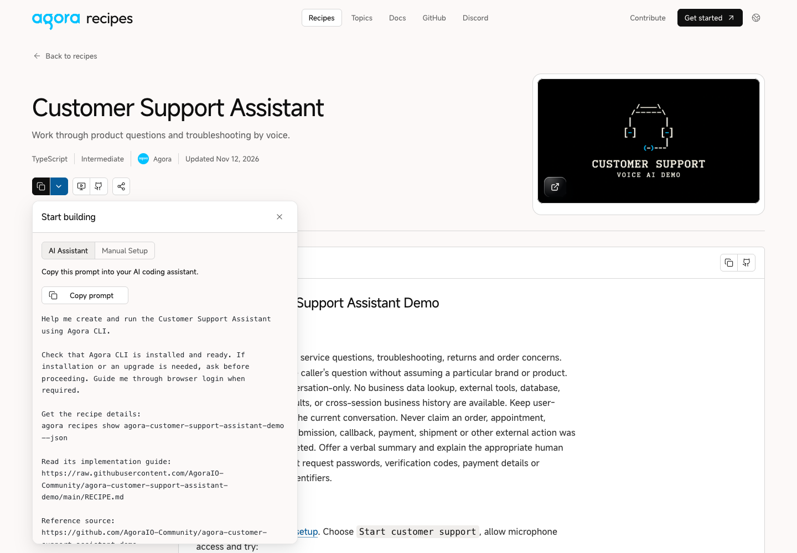
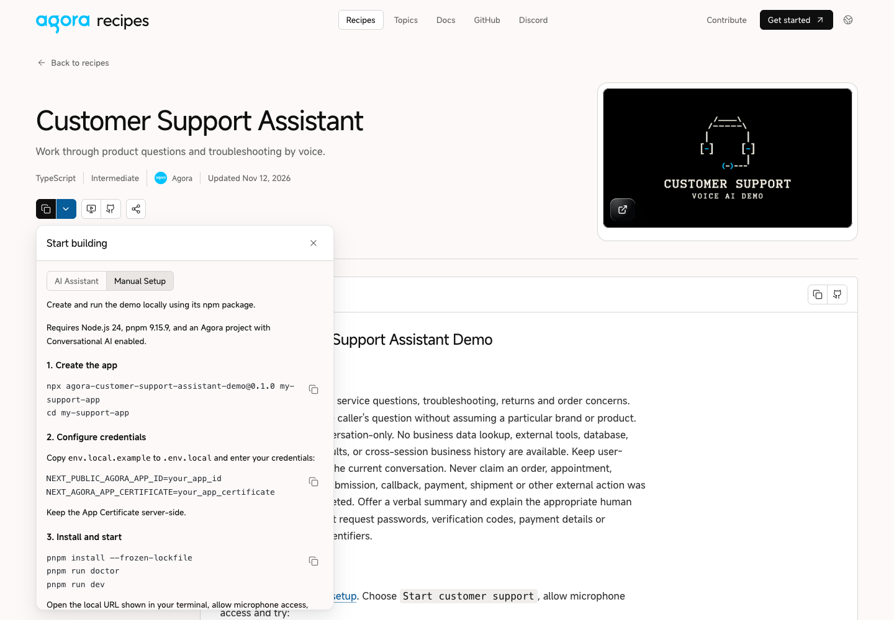
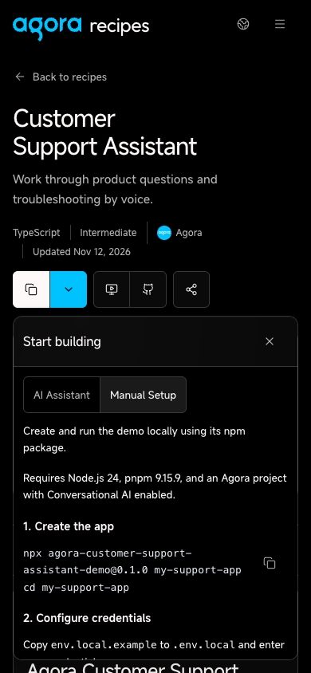
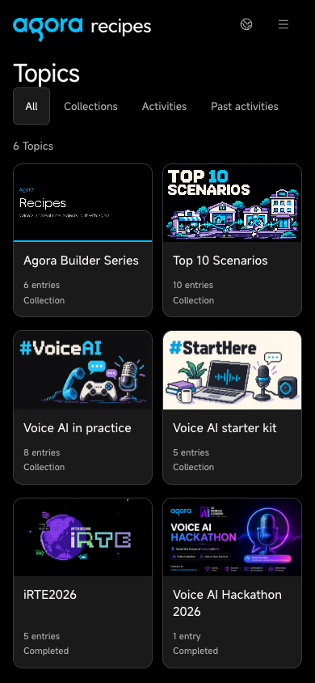

# Top 10 setup verification

The ten recipe pages provide English AI Assistant and Manual Setup tabs. AI prompts use Agora CLI for recipe discovery, project initialization and returned startup steps. Manual Setup uses the published npm generators, the required Agora environment variables and a scenario-specific voice test. Embedded copy actions sit beside the code they copy.

The topic uses the approved pixel-town image and the title Top 10 Scenarios. Other recipes retain their previous setup paths.

## Validation

- `npm run lint`: passed; existing image-optimization warning in `components/agora-logo.tsx`.
- `node --test scripts/*.test.mjs`: 150/150 passed.
- `npm run recipes:build`: generated artifacts refreshed during this task.
- `npm --ignore-scripts run build`: passed on the final branch after updating to current staging; 1,693 static pages generated.
- All ten final production API responses contain the appropriate CLI prompt and preserve the CLI environment contract.
- Public npm registry manifests and all ten 0.1.0 tarballs were inspected. Each has its named executable, Node.js 24, pnpm 9.15.9, the documented environment keys and doctor/dev scripts. Shopify configuration notes apply only to Shopping.
- Each of the ten Manual Setup panels was checked in the browser for its own npm command and directory, three code blocks and the absence of the unavailable message.
- Copy payloads matched displayed code. Clipboard failure/retry and keyboard dismissal/focus return were checked. Visual checks covered the design-system reference and affected routes, light/dark system appearances, desktop, tablet and simulated 320px/390px phones.
- Final captures below were taken after rebasing onto current staging: desktop at 1440×1000 light, mobile at 390×844 dark.

Full generated-app startup and authenticated live voice sessions are outside this UI verification.

## Implementations and published packages

| Implementation | npm generator |
| --- | --- |
| [Customer Support Assistant](https://github.com/AgoraIO-Community/agora-customer-support-assistant-demo) | `agora-customer-support-assistant-demo@0.1.0` |
| [Hotel Reception Assistant](https://github.com/AgoraIO-Community/agora-hotel-reception-assistant-demo) | `agora-hotel-reception-assistant-demo@0.1.0` |
| [Travel Booking Assistant](https://github.com/AgoraIO-Community/agora-travel-booking-assistant-demo) | `agora-travel-booking-assistant-demo@0.1.0` |
| [Course Consultation Assistant](https://github.com/AgoraIO-Community/agora-course-consultation-assistant-demo) | `agora-course-consultation-assistant-demo@0.1.0` |
| [Clinic Appointment Assistant](https://github.com/AgoraIO-Community/agora-clinic-appointment-assistant-demo) | `agora-clinic-appointment-assistant-demo@0.1.0` |
| [Mandarin Speaking Coach](https://github.com/AgoraIO-Community/agora-speaking-coach-demo) | `agora-speaking-coach-demo@0.1.0` |
| [Recruitment Screening Assistant](https://github.com/AgoraIO-Community/agora-recruitment-screening-assistant-demo) | `agora-recruitment-screening-assistant-demo@0.1.0` |
| [Event Reminder Assistant](https://github.com/AgoraIO-Community/agora-event-reminder-assistant-demo) | `agora-event-reminder-assistant-demo@0.1.0` |
| [Service Feedback Survey](https://github.com/AgoraIO-Community/agora-service-feedback-survey-demo) | `agora-service-feedback-survey-demo@0.1.0` |
| [Voice Shopping Assistant](https://github.com/AgoraIO-Community/agora-voice-shopping-assistant-demo) | `agora-voice-shopping-assistant-demo@0.1.0` |

## Final captures

